# Caso 1: gestión de flota y mantenimiento

Trabajo Práctico 2, etapa 2. Informática Aplicada, Tecnicatura Universitaria en Logística, UTN. Alumnas: Benitez Yanila Jasmin; Martinez Ruth Maillen , Dominguez Leonardo.

Aplicación web (React, TypeScript, Vite) sobre una base de datos Supabase (PostgreSQL). Todos los datos son inventados.

## Contenido

- `src/`: aplicación web.
- `supabase/migrations/0001_etapa1.sql`: base de la etapa 1 (tablas, reglas, triggers, RLS).
- `supabase/migrations/0002_etapa2.sql`: cambios de la etapa 2 (migración aditiva).
- `supabase/seed.sql`: datos ficticios de demostración.
- `docs/`: documento descriptivo, MER (etapas 1 y 2), modelo relacional, PDF de entrega y capturas.

## Puesta en marcha

1. Crear un proyecto en Supabase. En el editor SQL ejecutar, en este orden, `0001_etapa1.sql`, `0002_etapa2.sql` y `seed.sql`.
2. Copiar `.env.example` a `.env` y completar las dos variables con la URL del proyecto y la clave anónima (Project Settings, API). El archivo `.env` no se sube al repositorio.
3. `npm install` y luego `npm run dev`.

## Despliegue en Vercel

Importar el repositorio, cargar `VITE_SUPABASE_URL` y `VITE_SUPABASE_ANON_KEY` en las variables de entorno del proyecto y desplegar. Framework: Vite; comando de build `npm run build`; salida `dist`.

## Seguridad

- Las credenciales nunca van en el repositorio: solo `.env.example`, con los nombres y sin valores.
- Si alguna clave llegara a subirse, hay que rotarla en Supabase.
- La seguridad por filas (RLS) está activa en todas las tablas. Las políticas son abiertas porque la demostración elige el rol en pantalla; para producción corresponde usar Supabase Auth y políticas por rol.

## Capturas

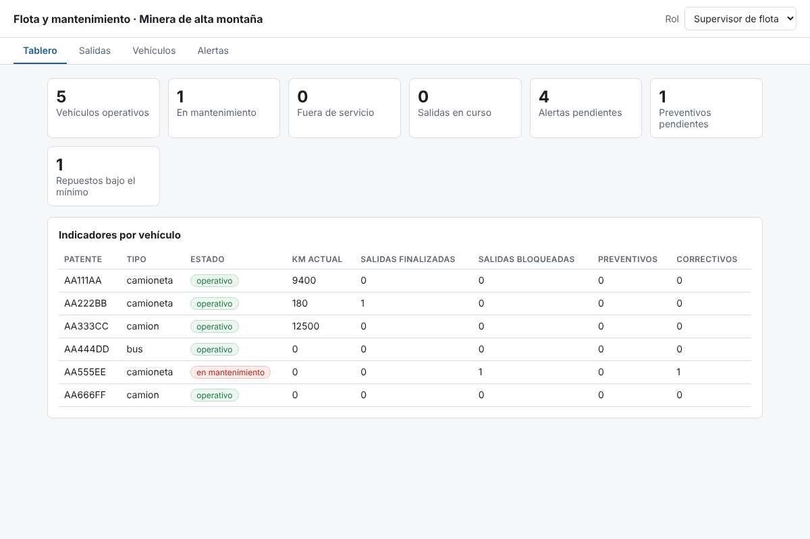
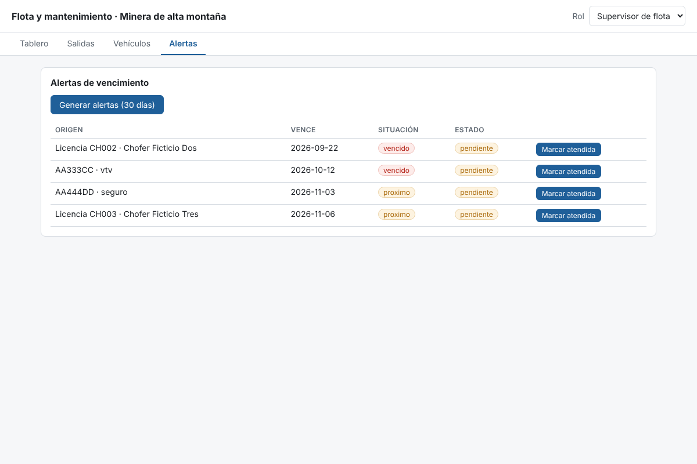
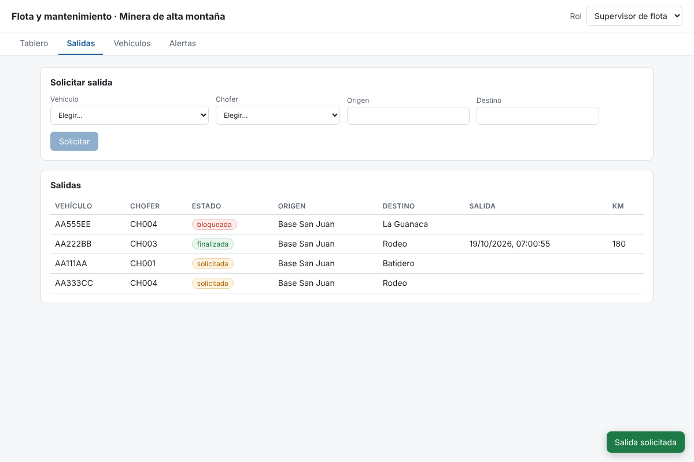
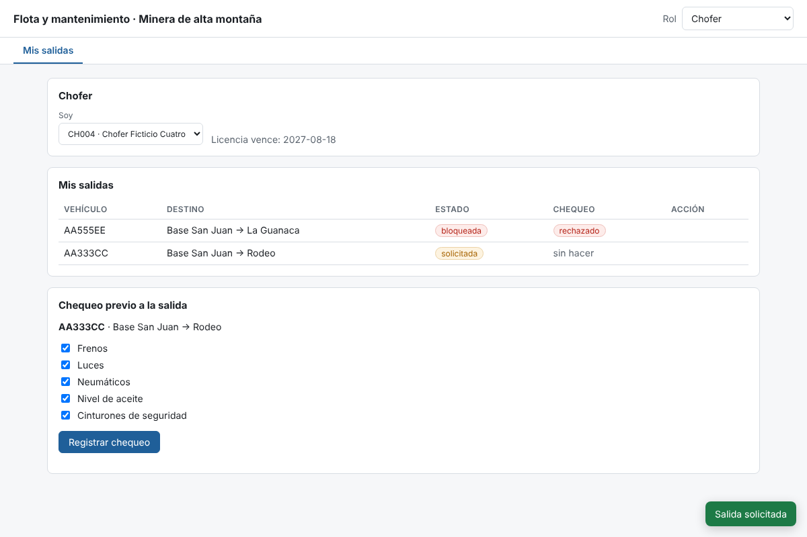
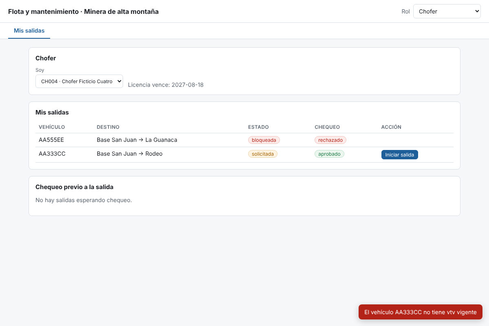
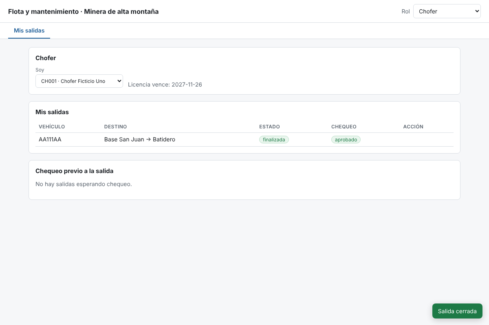
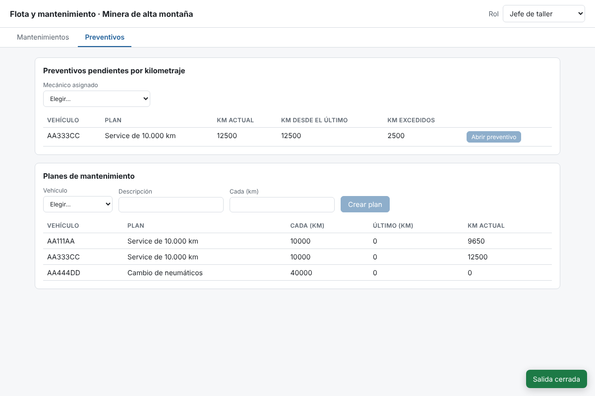
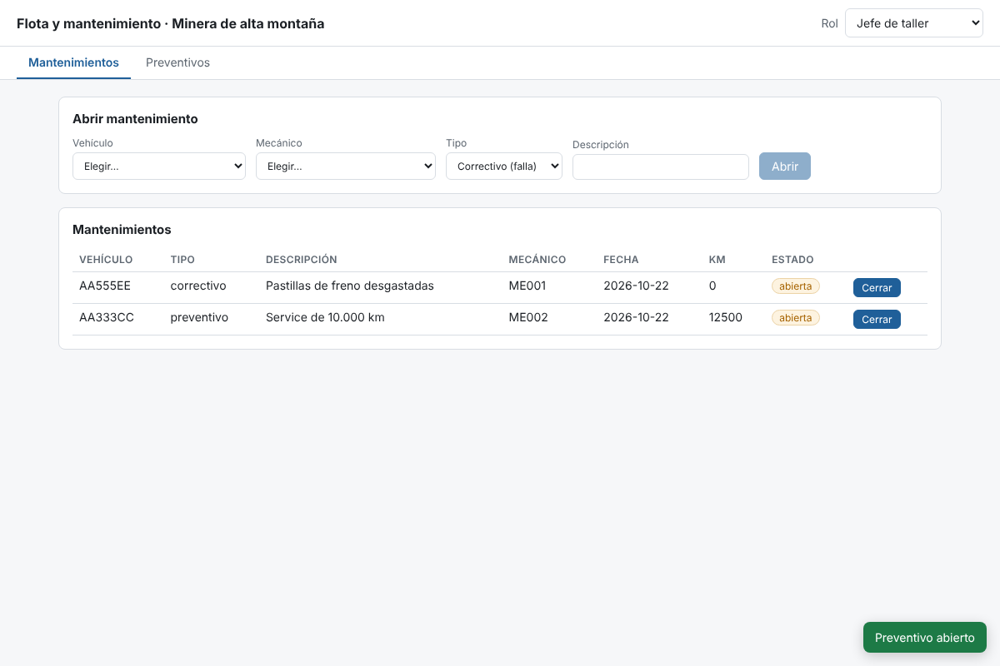
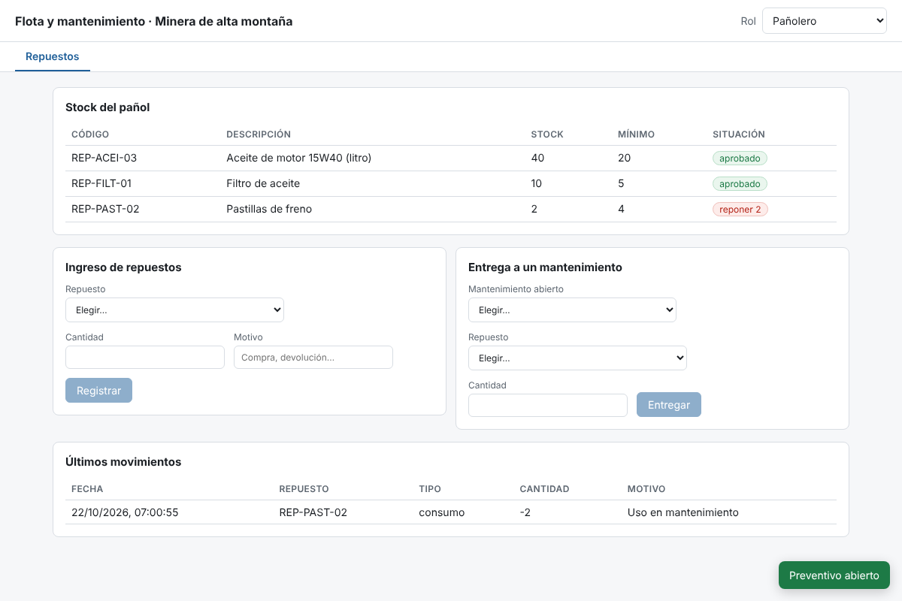
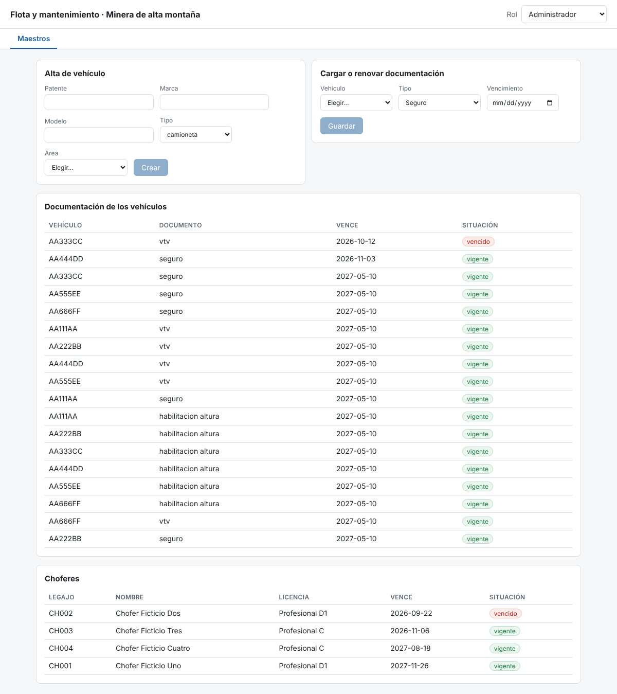
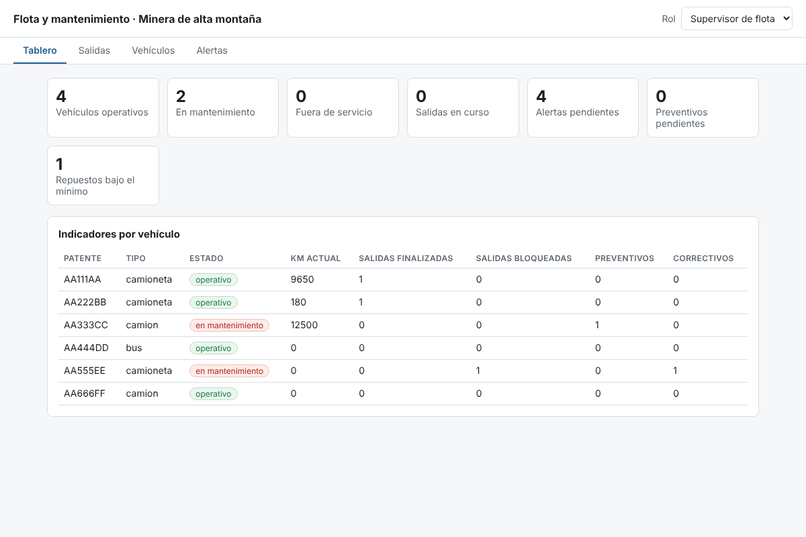
